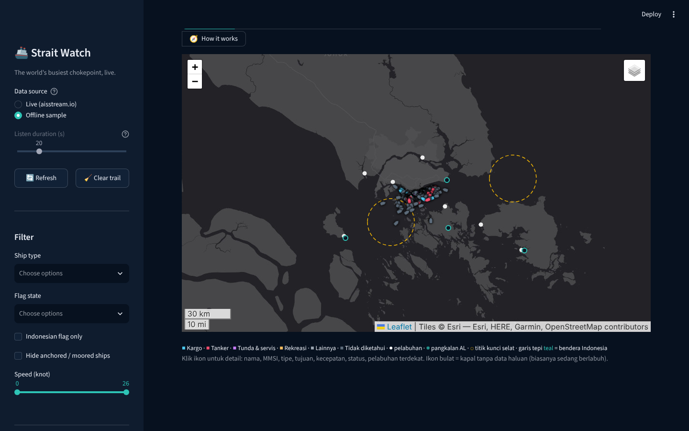
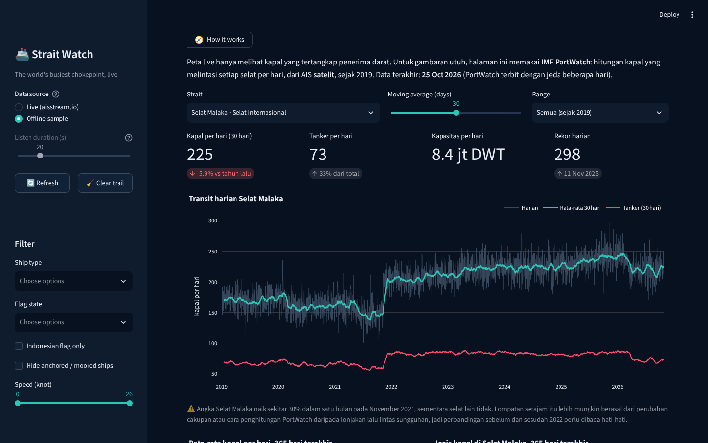
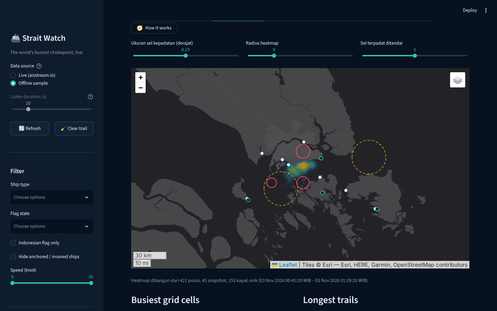
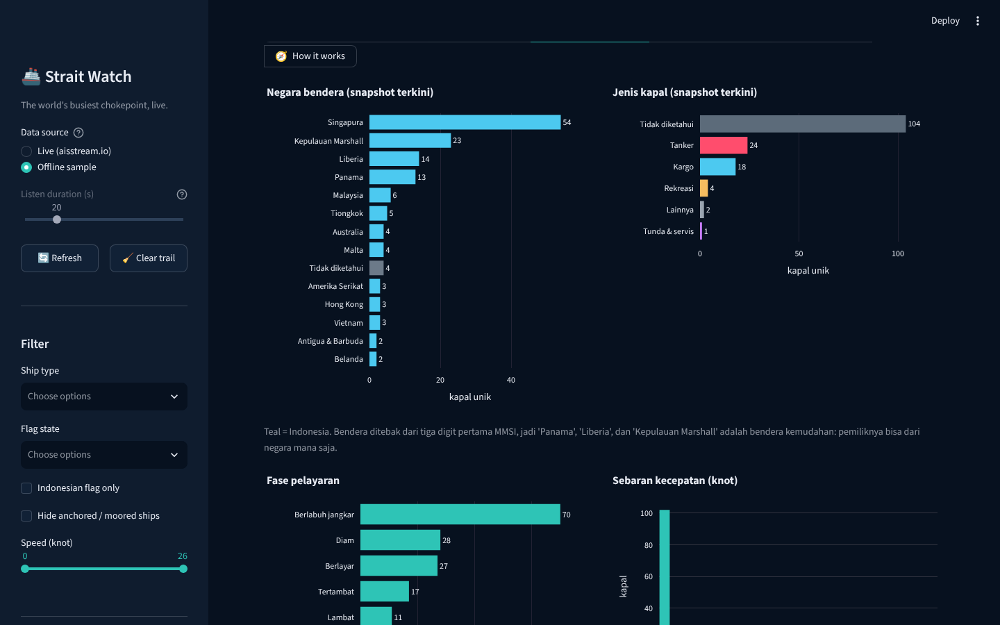
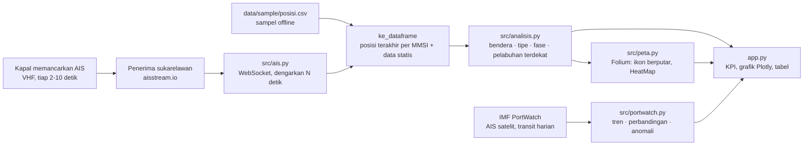

# 🚢 Strait Watch

[](https://github.com/Avalon2222/strait-watch/actions/workflows/tests.yml) [](https://www.python.org/) [](LICENSE) [](https://strait-watch.streamlit.app)

> **Seperempat perdagangan dunia lewat sini.** Peta live kapal di Selat Malaka dan Selat Singapura dari data AIS publik
> (aisstream.io), ditambah hitungan transit harian sejak 2019 dari AIS satelit (IMF PortWatch) untuk Selat Malaka,
> Sunda, Lombok, Makassar, dan Ombai: jenis kapal, negara bendera, tren, hari-hari yang tidak biasa, dan siapa yang
> sedang berada di titik tersempit selat atau di depan pangkalan TNI AL. Dibangun dengan Python, pandas, Streamlit,
> Folium, dan Plotly.

*A live map of ship traffic through the Strait of Malacca and the Singapore Strait from public AIS data (aisstream.io),
plus daily satellite-AIS transit counts since 2019 (IMF PortWatch) for Malacca and Indonesia's archipelagic sea lanes:
ship types, flag states, trends, unusual days, and who is sitting at the chokepoints right now. Python, pandas,
Streamlit, Folium, Plotly. Ships with an offline sample so it works without an API key.*

**🚀 Coba langsung di browser:** [strait-watch.streamlit.app](https://strait-watch.streamlit.app)



> ℹ️ **Disclaimer.** Seluruh data berasal dari **sumber publik** (aisstream.io, standar ITU, Wikipedia) dan bersifat
> edukatif. Ini bukan data operasional pelayaran dan tidak boleh dipakai untuk navigasi, pengawasan, atau keputusan
> keselamatan. Proyek ini merupakan portofolio pribadi, tidak berafiliasi dengan aisstream.io, otoritas pelabuhan,
> TNI AL, maupun operator kapal mana pun.

## Latar belakang

Selat Malaka adalah jalur laut tersibuk di dunia: sekitar 90.000 kapal per tahun, seperempat perdagangan global, dan
sebagian besar minyak yang menuju Tiongkok, Jepang, dan Korea. Di bagian tersempitnya, Selat Phillip dekat Singapura,
jalur pelayaran hanya selebar 2,8 km. Selat ini juga perairan yang dijaga tiga negara pantai (Indonesia, Malaysia,
Singapura) dan dilewati kapal perang dari banyak negara lain.

Setiap kapal niaga wajib memancarkan **AIS** (Automatic Identification System): identitas, posisi, kecepatan, haluan,
dan tujuan, lewat radio VHF yang tidak terenkripsi. Jaringan seperti aisstream.io mengumpulkan sinyal itu dari penerima
sukarelawan dan membukanya gratis. Proyek ini mendengarkan aliran tersebut selama beberapa detik, lalu bertanya: kapal apa
saja yang sedang berada di selat, bendera mana yang mendominasi, berapa tanker yang lewat, dan siapa yang ada di depan
Belawan, Batam, atau Tanjung Pinang saat ini?

Sekaligus, proyek ini menjadi latihan tiga hal: memakai **aliran WebSocket** (bukan API permintaan-jawaban), membaca
**standar terbuka** (MMSI, kode tipe kapal, status navigasi) untuk memperkaya data mentah, dan membuat **peta interaktif**
dengan ikon yang berputar mengikuti haluan.

## Fitur

| Halaman | Isi |
|---|---|
| 🚢 Live map | Satu ikon per kapal, diwarnai per jenis (tanker merah, kargo biru, dan seterusnya), diputar sesuai haluan, garis tepi teal untuk bendera Indonesia. Klik untuk nama, MMSI, tipe, tujuan, kecepatan, status, ukuran, pelabuhan terdekat. Lapisan per jenis kapal, pelabuhan, pangkalan AL, dan titik kunci selat dapat dimatikan |
| 📈 Strait traffic | Transit harian dari IMF PortWatch (AIS satelit) sejak 2019 untuk Selat Malaka, Sunda, Lombok, Makassar, Ombai, serta Hormuz, Suez, dan Taiwan sebagai pembanding: tren dengan rata-rata bergerak, tanker per hari, perbandingan antarselat, komposisi jenis kapal, rata-rata per tahun, dan daftar hari yang tidak biasa (z-score) |
| 🔥 Traffic heatmap | Heatmap dari seluruh posisi yang terekam (sampel offline, atau jejak yang terkumpul selama sesi live); jalur satu arah (traffic separation scheme) muncul dengan sendirinya. Tabel sel terpadat dengan label lokasi dan daftar jejak terpanjang |
| 👑 Who rules the strait | Grafik kapal unik per negara bendera dan per jenis, fase pelayaran, sebaran kecepatan, tujuan yang dilaporkan, dan komposisi kapal berbendera Indonesia |
| ⚓ Chokepoints & bases | Jumlah kapal (dan tanker) dalam radius tertentu dari One Fathom Bank, Selat Phillip, pintu-pintu selat, pelabuhan, dan pangkalan TNI AL; daftar kapal militer/penegak hukum yang memancarkan AIS |
| 📋 Data & sources | Tabel snapshot terkini, download CSV (snapshot atau seluruh jejak), daftar titik acuan, sumber dan keterbatasan |
| 🧭 How it works | Diagram alur data dari kapal sampai peta, tabel per langkah, penjelasan mengapa AIS "didengarkan" bukan "diminta" |
| 🎓 Learning mode | Toggle di sidebar: setiap halaman menampilkan expander berisi konsep (AIS, MMSI, bendera kemudahan, DivIcon berputar, grid kepadatan, haversine) beserta potongan kode |

Sidebar menyediakan pilihan sumber data (**Live** dengan cadangan otomatis ke sampel bila aliran gagal, atau
**Offline sample**), lama mendengarkan (10–60 detik), tombol Refresh, serta filter jenis kapal, bendera, kapal berlabuh,
dan kecepatan.

Mode live memakai [aisstream.io](https://aisstream.io): gratis untuk penggunaan non-komersial, kunci API didapat
dengan masuk memakai akun GitHub. Catatan jujur: penerima aisstream.io di kawasan ini masih jarang, sehingga peta live
terutama menangkap kapal di sekitar Singapura. Karena itu halaman **Strait traffic** memakai AIS satelit dari IMF
PortWatch untuk gambaran seluruh selat. Kunci dibaca dari variabel lingkungan `AISSTREAM_API_KEY`, dari
`.streamlit/secrets.toml`, atau diketik langsung di sidebar:

```toml
[aisstream]
api_key = "..."
```





## Cara menjalankan

```bash
git clone https://github.com/Avalon2222/strait-watch.git
cd strait-watch
python -m venv .venv && source .venv/bin/activate   # Windows: .venv\Scripts\activate
pip install -r requirements.txt
streamlit run app.py
```

Buka `http://localhost:8501`. Jalankan pengujian dengan `python -m pytest tests/ -v` (83 tes; otomatis jalan di
GitHub Actions setiap push dan pull request). Tanpa kunci API, pilih **Offline sample** di sidebar; peta dasar tetap
memerlukan koneksi untuk mengunduh tile Esri.

Untuk merekam sampel baru (misalnya pada jam sibuk siang hari):

```bash
AISSTREAM_API_KEY=... python scripts/rekam_sampel.py --durasi 600 --interval 60
```

## Cara kerja (ringkas)



| Fungsi | Yang dilakukan |
|---|---|
| `ais.kumpulkan(api_key, durasi)` | Membuka WebSocket, mengirim pesan langganan (kunci, kotak batas, jenis pesan), menyimpan posisi terakhir tiap MMSI dan data statis selama N detik; kegagalan menjadi `AisError` |
| `ais.urai_pesan(pesan)` | Satu pesan JSON menjadi baris posisi atau statis; membuang nilai "tidak tersedia" AIS (SOG 102,3; COG 360; heading 511) dan karakter `@` pada nama |
| `ais.ke_dataframe(posisi, statis)` | Gabung posisi dan data statis menjadi satu baris per kapal |
| `mmsi.negara_bendera(mmsi)` | Tiga digit pertama MMSI → negara (ITU-R M.585); stasiun pantai dan pelampung dikenali dari awalan khusus |
| `mmsi.kategori_tipe(kode)` | Kode tipe 0–99 → kargo, tanker, penumpang, nelayan, tunda & servis, militer & penegak hukum, dan lain-lain |
| `analisis.fase_pelayaran(sog, status)` | Berlabuh jangkar / tertambat / diam / lambat / berlayar dari SOG dan status navigasi |
| `analisis.perkaya(df, pelabuhan)` | Menambah bendera, kategori, fase, km/jam, arah ikon (COG saat bergerak, heading saat diam), pelabuhan terdekat (haversine) |
| `analisis.hitung_unik(df, kolom)` | Kapal unik (MMSI) per kategori, agar jejak tidak menggandakan hitungan |
| `analisis.grid_kepadatan(df, ukuran)` | Membagi laut menjadi sel 0,1–0,5° dan menghitung posisi serta kapal unik per sel |
| `analisis.sibuk_per_titik(df, titik, radius)` | Kapal dan tanker dalam radius X km dari setiap titik kunci, pelabuhan, atau pangkalan |
| `portwatch.ambil_harian(portids)` | Mengunduh transit harian per selat dengan paginasi; halaman yang ditolak server dicoba ulang pada putaran berikutnya |
| `portwatch.bandingkan(df)` / `komposisi` / `anomali` | Rata-rata harian dan porsi tanker per selat, komposisi jenis kapal, hari dengan z-score ≥ 2,5 terhadap 28 hari sebelumnya |
| `peta.ikon_kapal(warna, arah)` | DivIcon SVG lambung kapal yang diputar dengan `transform: rotate()`; lingkaran bila arah tidak tersedia |

## Data

| File | Isi |
|---|---|
| `data/sample/posisi.csv` | Rekaman posisi kapal per bucket 60 detik (lihat bagian *Sampel* di bawah) |
| `data/sample/kapal_statis.csv` | Nama, tipe, tujuan, dan dimensi kapal yang sempat mengirim pesan statis selama perekaman |
| `data/portwatch_harian.csv` | Transit harian 8 selat sejak 1 Januari 2019 dari IMF PortWatch, diperbarui otomatis setiap Senin oleh GitHub Actions (`.github/workflows/portwatch.yml`) |
| `data/portwatch_chokepoint.csv` | Ringkasan setahun 28 chokepoint dunia dari basis data PortWatch |
| `data/pelabuhan.csv` | 24 pelabuhan di tiga negara pantai dan 9 pangkalan AL (7 TNI AL, Changi, Lumut) dengan koordinat Wikipedia |
| `data/titik_kunci.csv` | Empat titik acuan selat: pintu utara, One Fathom Bank, Selat Phillip, pintu timur Selat Singapura |
| `src/mmsi.py` | Pemetaan 150-an MID ke negara, kode tipe ke kategori, kode status navigasi ke teks |

Sampel offline direkam dengan `scripts/rekam_sampel.py` pada **3 November 2026 pukul 00.45–01.29 WIB** (45 snapshot per menit,
421 baris, 153 kapal unik, 67 kapal dengan data statis). Data PortWatch mencakup **22.840 baris**, 8 selat, 1 Januari 2019
sampai 25 Oktober 2026.

Catatan keterbatasan lengkap ada di [`data/SUMBER_DATA.md`](data/SUMBER_DATA.md): cakupan penerima tidak merata (pantai
Malaysia dan Singapura jauh lebih rapat daripada pantai Sumatera), hanya kapal ber-AIS yang terlihat, tipe dan tujuan
diisi manual oleh operator, dan bendera bukan kepemilikan.

## Catatan pengamatan (pendapat pribadi)

Dari sampel live dan data transit PortWatch, beberapa hal yang menarik:

1. **Selat Malaka adalah jalur tanker.** Dalam 365 hari terakhir, sekitar 34% transit adalah tanker, rata-rata lebih dari
   70 tanker per hari. Hormuz punya porsi tanker lebih tinggi, tetapi Malaka melewatkan lebih banyak tanker secara jumlah:
   minyak dari Teluk harus melewati keduanya untuk sampai ke Asia Timur.
2. **Sekitar 227 kapal niaga per hari**, lebih dari lima kali Terusan Suez dan setara Selat Taiwan di antara
   selat pembanding. Rekor harian tercatat 298 kapal pada 11 November 2025.
3. **Jalur ALKI jauh lebih sepi, tetapi berbeda karakter.** Selat Makassar dan Lombok (ALKI II) didominasi kapal curah
   kering: batu bara dan bijih dari Kalimantan dan Australia, serta kapal besar yang terlalu dalam untuk Malaka.
   Selat Sunda (ALKI I) lebih campuran.
4. **Bendera Indonesia hampir tidak terlihat di peta live**, tetapi itu cerita tentang penerima, bukan kapal: penerima
   aisstream.io terkumpul di Singapura, sehingga yang tertangkap adalah kapal berbendera Singapura dan bendera kemudahan
   (Kepulauan Marshall, Liberia, Panama) yang berlabuh di sana. Kapal domestik Indonesia di pantai Sumatera nyaris
   tidak tertangkap. Peta yang "kosong" ini justru argumen bagus untuk menambah penerima AIS di pantai timur Sumatera.
5. **Data juga bisa menipu.** Angka transit Selat Malaka di PortWatch naik sekitar 30% dalam satu bulan pada November
   2021 sementara selat lain datar. Lompatan setajam itu lebih mungkin perubahan cara penghitungan daripada lalu lintas
   sungguhan, sehingga tren jangka panjang sebaiknya dibaca mulai 2022.

## Struktur repositori

```
strait-watch/
├── app.py                      # tampilan Streamlit (dibaca dari atas ke bawah)
├── src/
│   ├── ais.py                  # klien WebSocket aisstream.io + parser pesan
│   ├── mmsi.py                 # MID → negara bendera, kode tipe → kategori, status navigasi
│   ├── analisis.py             # haversine, fase, kapal unik, grid, kapal di sekitar titik
│   ├── portwatch.py            # klien IMF PortWatch + tren, perbandingan, anomali
│   ├── muat_data.py            # pelabuhan, titik kunci, sampel offline, live-dengan-cadangan
│   └── peta.py                 # Folium: ikon berputar, heatmap, lapisan
├── scripts/
│   ├── rekam_sampel.py         # rekam N menit aliran ke CSV
│   └── perbarui_portwatch.py   # unduh ulang transit harian PortWatch
├── data/
│   ├── pelabuhan.csv
│   ├── titik_kunci.csv
│   ├── portwatch_harian.csv, portwatch_chokepoint.csv
│   ├── sample/posisi.csv, kapal_statis.csv
│   └── SUMBER_DATA.md
├── docs/
│   ├── BELAJAR.md              # panduan belajar langkah demi langkah
│   ├── LATIHAN.md              # latihan bertingkat dengan kunci
│   └── screenshots/
├── tests/                      # 83 tes pytest: mmsi, ais, analisis, data, portwatch
└── requirements.txt
```

## Belajar dari proyek ini

- [`docs/BELAJAR.md`](docs/BELAJAR.md): dari apa itu AIS dan MMSI, cara mendengarkan WebSocket dengan batas waktu,
  menebak bendera dan jenis kapal dari standar ITU, sampai heatmap dan ikon berputar.
- [`docs/LATIHAN.md`](docs/LATIHAN.md): 11 latihan dari menambah pelabuhan di CSV sampai membuat filter koridor,
  deteksi kapal "diam di tengah jalur", dan tes baru, lengkap dengan petunjuk dan kunci.

## Lisensi

Kode berlisensi MIT. Data posisi kapal dari [aisstream.io](https://aisstream.io) tunduk pada ketentuan layanannya
(penggunaan non-komersial). Data transit dari [IMF PortWatch](https://portwatch.imf.org) (IMF dan University of Oxford),
dikutip sesuai atribusinya. Tabel MID dan kode AIS dari rekomendasi ITU yang bersifat publik. Peta dasar oleh Esri.
